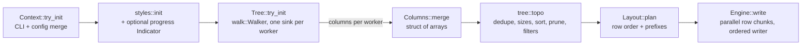

# Repository Guidelines

## Project Overview

`erdtree` (binary `erd`) is a cross-platform, multithreaded filesystem and disk-usage tool. It combines parts of `du`, `tree`, `find`, `wc`, and `ls`: it respects `.gitignore` and hidden-file rules, reports physical/logical/block/word/line sizes, supports regex/glob filtering, several layouts, sorting, icons, `LS_COLORS`, and a Unix long view.

## Architecture & Data Flow

Single Cargo package, single binary. `src/main.rs` is the only orchestration point:



- **Context** (`src/context/`): `Context` is a clap derive struct that also carries derived runtime state (column widths, color policy, predicates). `Reconciler::compute_args` in `src/context/args.rs` merges config per argument using clap `ValueSource`: an explicit CLI value wins, config replaces defaults. Argument relations (`requires`, the `searching` group) are NOT declared on `Context`; `with_relations` in `args.rs` adds them and they are enforced once on the merged args, so add new relations there. TOML keys are converted to `--kebab-case` args (`src/context/config/toml/mod.rs`); `false` booleans are omitted. `--no-config` skips config. Legacy `.erdtreerc` (`src/context/config/rc.rs`) takes precedence over TOML when present; named profiles (`-c NAME`) are TOML-only.
- **Walk** (`src/walk/`): `Walker` (configured by `walker()` in `src/tree/mod.rs`) runs up to `--threads` workers: worker 0 runs on the calling thread, and another starts only when a worker has two or more local jobs and none is idle, or splits a listing, so a tree with nothing to share never spawns a thread. A worker lists a whole directory into a reusable `Listing` (`src/walk/listing.rs`: one name arena with a NUL after each name, plus inode and `d_type` per entry), applies the ignore rules and the entry filter, and appends a record per kept entry to its own `Sink`. Records carry a platform-neutral `Stat` and `Kind` (`src/fs/stat.rs`), not `std::fs::Metadata`. Directories move between workers through a shared queue only when a worker is idle, and a directory with at least `SPLIT_MIN` (1024) entries is visited in blocks that idle workers take over (lazy binary splitting), so its records can live in several sinks (`--disk-usage line|word` split from 2 entries in blocks of 1, since each entry is a file read; `Tuning::reading_files`). Entries whose metadata fails are dropped with their contents and count as ignored (a `DT_DIR` entry is only stat'ed by the job that opens it, which counts it then). A queued job keeps its parent's directory fd open to open relative to it; `src/walk/fds.rs` budgets those fds from `RLIMIT_NOFILE`, and a job over budget opens by path, except paths of 4000 bytes or more, which need the fd. Ignore files and `--follow` loop checks (device and inode of the walked directories) work relative to the fd, so they hold beyond `PATH_MAX`. Unless `--threads` is given (`Context::threads_explicit`, from clap `ValueSource`; a config `threads` counts), workers that block on I/O add workers: each worker adds its task wall time and, after 5 ms, compares it with its thread CPU time and voluntary context switches (`getrusage(RUSAGE_THREAD)`, Linux only, `src/walk/adaptive.rs`); a blocked window doubles the worker count up to `min(8 * threads, 64)` (`Walker::max_threads`). Extra workers use sinks after the root's and only walk; render and sort keep `threads`. Warm runs never trigger it, since preemption is not a voluntary switch. `src/walk/rules.rs` is adapted from the `ignore` crate's `dir.rs`, so ignore-file precedence matches `ignore::WalkParallel`; `tests/walk_oracle.rs` checks the walk against that walker, so keep both in step when changing either. A directory without ignore files shares its parent's `Rules` (not under `--follow`, and not for the root), and the global gitignore is built only once a repository is seen.
- **Linux walk** (`src/fs/at.rs`, `cfg(target_os = "linux")`): a directory is opened with `openat` relative to its parent's fd (the job holds an `Arc<OwnedFd>`; the soft `RLIMIT_NOFILE` is raised), read with raw `getdents64` (`d_type`, `statx` on `DT_UNKNOWN`), and each entry is stat'ed with `statx(dirfd, name)` asking only for the needed fields (`fstatat64` if `statx` is unavailable). The record of a directory that will be read is stored by the job that reads it, from `statx` of its open fd (`Me::Deferred`); `--traversal-depth` leaves keep the by-name stat, and a directory whose open fails is still recorded, without contents. Per-entry `readlinkat`, `listxattrat` (syscall 465, with a path-based fallback), `openat` for `-d line`/`-d word` and the orphaned-link check go through `Record::{read_link, has_xattrs, open, target_exists}` using the directory fd, so no path longer than `PATH_MAX` fails a call; paths beyond it are now walked. Listings of at least 10000 entries on local file systems are visited in inode order. Windows keeps `std::fs::read_dir` behind the same `Listing` interface.
- **macOS walk** (`src/fs/bulk.rs`, `src/fs/at.rs`, `cfg(target_os = "macos")`): the same fd-relative walk (`Arc<DirFd>`, budget, `openat`, `readlinkat`, `fstatat`, ignore files and `--follow` loop checks through the directory fd), but a directory is listed with `getattrlistbulk` (names plus metadata in one call; `ATTR_CMN_OBJTYPE` is always requested, since APFS otherwise takes a slow per-entry path; `ATTR_CMN_ERROR` follows the attribute sets) or with `readdir`, chosen per directory: subdirectories use bulk when their parent recorded at least a third of its files, and very large directories use `readdir` with several workers so the `fstatat` calls can be shared. A directory's record always comes from `fstat` of its open fd (Cryptex graft roots report other metadata in bulk); a non-directory's bulk stat is trusted only on APFS, without errors, outside data vaults and when the mode agrees with the object type, otherwise `fstatat`. Paths of 1024 bytes or more behave as with path-based calls (`at::fits_path_max`). The default thread count is the number of performance cores (`hw.perflevel0.physicalcpu`, `Context::num_threads`): more threads than that multiply kernel time on APFS. Directory `openat` dominates what is left (its kernel cost grows with depth). Walking `/dev/fd` shows erd's own held directory fds.
- **Columns** (`src/tree/columns.rs`): each record becomes one row of struct-of-arrays columns (names arena with `usize` end offsets (no size limit), per-directory parent runs, depth, `Kind`, size). Data only some options need (mode for the long view and `--classify`, blocks, timestamps, long-view attributes) is collected only when `Probe` says so, and `LS_COLORS` styles are a `u16` index into a small table, resolved from the `Stat` by `src/styles/entry.rs` (a replica of `lscolors` 0.21 `indicator_for`, tested against `lscolors`); symlink targets and multiply-linked inodes are sparse lists. All filesystem I/O happens here, during the walk; later stages are CPU only. Keep it that way. `Columns::merge` keeps the largest sink in place and appends the others into exactly reserved space.
- **Assembly** (`src/tree/mod.rs`, `src/tree/topo.rs`, `src/tree/widths.rs`): `Columns::merge` concatenates the sinks and resolves parent references; for large trees groups of columns are copied by separate threads (the largest sink keeps its columns in place), which also spreads the page faults of the new memory, and it records the runs of equal parents for `Children`. `topo` holds the pure index algorithms (child lists, parent-first order by depth, pre-order, hard-link dedupe, size totals, prune, dirs-only, min-size) with Kani proofs. `assemble` relies on the `depth` column being the distance from the root (parent depth + 1): `aggregate` sums each directory's files over the child lists (shared out between threads) and then adds directories to their parents deepest first, a counting sort by depth is the parent-first order for `prune` and `hide_small` (built only when those run), and `preorder` stops at `--level` when no filter (`--prune`, `--pattern`, `--dirs-only`, `--min-size`) needs the whole tree (`Tree::order`/`has_children` then stop at the level; `file_count` is computed separately and still covers everything). `Children` stores each parent's children as a range of `list`, built by copying the runs of equal parents (a directory is stored by the job that reads it, so its children form several runs). Child lists are sorted by packed integer keys (`SortKeys` in `src/tree/node/cmp.rs`: directory class, size or time, 8-byte name prefix) with the full comparator only for equal keys, ties broken by name; long lists are sorted by all threads, and `src/tree/psort.rs` merges the sorted chunks with co-ranked pieces so that the last merge also uses all threads. A key must never order two nodes against the comparator, so change `SortKeys` together with the comparators. Hard-link dedupe sorts `(dev, ino, nlink)` and ranks group members without building paths (`Tree::path_cmp`). Column widths come from maxima over the columns (`widths.rs`), with one maximum per unit for `--human`. `Node` (`src/tree/node/`) is a `Copy` view (`&Tree`, index) used by sorting and rendering.
- **Disk usage** (`src/disk_usage/`): metric variants (logical, physical, block, line, word) and unit prefixes. Physical size falls back to metadata length.
- **Render** (`src/render/`): generic `Engine<T>` with layouts `Regular`, `Inverted`, `Flat`, `FlatInverted` (`src/render/layout/`). A layout returns `Rows`: either the shown nodes in pre-order (tree layouts; the box-drawing prefix of each row is computed from its ancestors by a per-worker `prefix::Cursor`, so any chunk of rows can start anywhere) or an explicit `Plan` (flat layouts, and tree layouts with `--follow`, whose link theme is stateful and needs the sequential plan). Flat plans carry `paths::DirPaths` (each shown directory's lossy path plus separator, built once in pre-order), so a flat row is the parent's prefix plus the validated name; the plan also software-prefetches the scattered columns of rows 16, 8 and 4 ahead (`Plan::prefetch`, x86-64 only), which halves flat render CPU. `row::RowFmt` is built once per run from `Context` and appends each row as bytes (no `Display`/`format!`): integers via `bytes.rs`, escape sequences precomputed per style (`theme::StyleCache`), names via `from_utf8` with the lossy fallback, `--truncate` through `Escaped::truncate`. Padding must stay `{:>w$}`-identical (counts chars). `Engine::write` runs `write_chunked`: persistent workers claim chunks of 4096 rows, an ordered writer on the calling thread overlaps the write syscall, buffers are recycled; with one thread or at most 8192 rows nothing is spawned. The last tree is leaked on purpose (`main::render`). The Unix long view is in `src/render/long/` (permission cells cached per mode, timestamps from a cached hourly UTC offset; `IsoStrict` and times outside 1970 to 2100 use chrono).
- **Styles** (`src/styles/`): global `OnceLock` themes and `LS_COLORS`. macOS `LSCOLORS` is not parsed. `NO_COLOR` uses `OnceLock` (`src/context/color.rs`).

Pitfalls:
- Walk order and record order are not tree order. Only assembly sorts.
- A tree deeper than `PATH_MAX` is walked on Linux (everything is relative to directory fds); `tests/deep_path.rs` covers it. `tests/walk_threads.rs` and `walk::test` compare many threads with one on directories above the split threshold; the integration helper `run_cmd` uses `--threads 1`, so splitting is not covered by the other integration tests.
- `--level` limits display only; traversal and size totals still cover the full tree. `--traversal-depth` (same depth numbering, root = 0) limits the walk itself (`Walker::max_depth`), so sizes and counts then cover only traversed entries.
- `--dirs-only`, prune and `--min-size` clear `alive` flags after sizes are computed; column widths are computed over all nodes except after `--min-size`.
- An inode reached more than once counts once, towards the entry not reached through a symlink, then with the least path.

## Key Directories

| Path | Purpose |
|---|---|
| `src/context/` | CLI args, config discovery/merge, platform options, `error.rs` |
| `src/walk/` | Parallel walker, directory listings (`listing.rs`) and ignore rules (`rules.rs`) |
| `src/tree/` | Columns, assembly, `topo.rs` algorithms and Kani proofs, `node/`, `error.rs` |
| `src/disk_usage/` | Size metrics (`file_size/`) and units |
| `src/render/` | Layout engine, row writer, prefix cursor, long view |
| `src/styles/`, `src/icons/` | Colors, themes, icons |
| `src/fs/` | `Stat`/`Kind` (`stat.rs`), Linux dirfd syscalls (`at.rs`), inode, Unix permissions, xattrs |
| `tests/` | Integration tests (one target per file), `tests/data/` fixtures |
| `example/` | `.erdtree.toml` (with `du`/`ls`/`rs` profiles) and legacy `.erdtreerc` |
| `assets/` | README screenshots only |
| `scripts/performance_metrics.sh` | macOS-only, needs root, purges disk cache, times `target/release/erd <args>` |

## Development Commands

Run commands inside the Nix dev shell (`flake.nix`, toolchain from `rust-toolchain.toml` via rust-overlay): `nix develop -c <cmd>`, or `nix develop` once.

```sh
cargo build                     # debug build
cargo run -- --threads 1 tests/data   # run erd on fixtures
cargo fmt --all -- --check      # CI gate; rustfmt.toml: match_block_trailing_comma = true
cargo clippy --all-targets --locked -- -D warnings   # CI gate
cargo test --locked             # CI gate (Linux, macOS, Windows)
cargo build --release --locked  # plain release build
dist plan                       # preview release artifacts (needs cargo-dist: nix shell nixpkgs#cargo-dist)
nix fmt flake.nix               # format flake.nix
nix flake check                 # crane checks: package build, clippy -D warnings, fmt, tests
nix build                       # crane release build (result/bin/erd); `nix run . -- <args>`
```

## Code Conventions & Common Patterns

- Rust edition 2024, MSRV 1.88 (`Cargo.toml`). Do not use std APIs newer than 1.88. Colors use `nu-ansi-term` (also enabled in `lscolors`); lazy statics use `std::sync::{OnceLock, LazyLock}`.
- Lints: `src/main.rs` enables `clippy::all`, `pedantic`, `nursery`, `cargo`, and more; CI denies all warnings. Fix lints instead of adding allows; a narrow `#[allow]` needs a comment with the reason (see `src/walk/mod.rs`).
- Errors: per-subsystem `thiserror` enums (`src/context/error.rs`, `src/context/config/toml/error.rs`, `src/tree/error.rs`) with `From` conversions and `?`. Only `main` prints errors (stderr, once) and sets the exit code.
- Platform code: gate with `#[cfg(unix)]` / `#[cfg(windows)]` at module, field, and match-arm level (see `src/fs/`, `src/tree/columns.rs`). Windows builds on stable (hard-link identity via `windows-sys` in `src/fs/inode.rs`); CI builds and tests Windows, so keep both platforms compiling.
- Options are `Copy` + clap `ValueEnum` enums where practical. Global immutable state uses `OnceLock`; no other shared mutable state.
- New CLI flag: add it to `Context` (or a sub-struct) with a doc comment (clap uses it as help text), make sure TOML kebab/snake keys map to it, then update the literal `erd --help` output in `README.md` (Usage section).
- `CONTRIBUTING.md`: rustdoc on every function/struct/trait; update README for user-visible changes; output changes need integration tests; open an issue before a PR. No commit-style rule is defined.

## Important Files

- `src/main.rs`: entry point, lint policy, renderer selection.
- `src/context/mod.rs`: all CLI options and defaults (threads default: `available_parallelism`, fallback 3).
- `src/context/args.rs`: CLI/config reconciliation.
- `src/context/config/toml/mod.rs`: TOML discovery. Unix order: `$ERDTREE_TOML_PATH`, `$XDG_CONFIG_HOME/erdtree/.erdtree.toml`, `$XDG_CONFIG_HOME/.erdtree.toml`, `$HOME/.config/erdtree/.erdtree.toml`, `$HOME/.erdtree.toml`. Windows: `%APPDATA%\erdtree\.erdtree.toml`. Legacy rc uses `$ERDTREE_CONFIG_PATH`.
- `src/walk/mod.rs`, `src/tree/mod.rs`: walk and tree assembly.
- `.github/workflows/ci.yml`: fmt, clippy, tests on Linux/macOS/Windows, clippy for the release targets no other job builds (aarch64 and musl Linux, x86-64 macOS, plus i686 Linux; `cross` job), MSRV `cargo check` on 1.88.0, `cargo deny check` (`deny` job, config in `deny.toml`: advisories, licenses allowlist, bans warn on duplicates/wildcards, crates.io-only sources), aggregated into the `ci-pass` job (the required check for `master`; it reads the conclusion of every job of the run through the API, since `needs.*.result` missed cancelled matrix legs).
- `.github/workflows/release.yml`: generated by cargo-dist; never edit by hand. Config lives in `dist-workspace.toml` (targets, installers `shell`/`powershell`, sha256, attestations, native `ubuntu-24.04-arm` runners for aarch64 Linux, no crates.io publish) plus `[profile.dist]` in `Cargo.toml`. After changing config run `dist generate` (`dist generate --check` verifies it is current). `dist plan` runs on every PR; pushing a tag builds and publishes a GitHub Release.
- Release procedure: bump `version` in `Cargo.toml`, update `CHANGELOG.md`, merge, then push tag `vX.Y.Z` (any tag matching `**[0-9]+.[0-9]+.[0-9]+*` that matches the Cargo version; prerelease versions such as `v3.2.0-rc.1` publish as prereleases). The crate is not published to crates.io (that name is upstream's).
- `rust-toolchain.toml`: pinned dev/CI toolchain (1.99.0). Bump it deliberately and fix new lints in the same PR; `nix develop` and CI both follow it.
- `flake.nix` / `flake.lock`: dev shell, `packages.erdtree` (default), and `checks` (`erdtree`, `clippy`, `fmt`, `test`) built with crane. The crane source set is `commonCargoSources` plus `tests/`; add other non-Cargo files that builds or tests read to that fileset. The `test` check skips `styles::entry::test::matches_lscolors_for_every_kind_of_entry`, since the Nix sandbox refuses setuid/setgid bits. Update with `nix flake update`.
- `CHANGELOG.md`: SemVer release notes.

## Runtime/Tooling Preferences

- Cargo; no workspace, no Cargo features, no profile overrides. CI installs the `rust-toolchain.toml` version with `rustup toolchain install`; the `msrv` job overrides it with `RUSTUP_TOOLCHAIN: 1.88.0`. When raising `rust-version` in `Cargo.toml`, update that job.
- macOS start-up: the binary must link only `libSystem` (check `otool -L target/release/erd`); dyld loading frameworks cost about 1.5 ms per run. `src/build.rs` passes `-Wl,-dead_strip_dylibs` on macOS, and chrono is built without its `clock` feature on macOS (iana-time-zone links CoreFoundation): the long view's local time zone comes from `tz-rs` (`src/render/long/zone.rs`, following chrono's `TZ` rules; `zones_match_chrono` compares them). Do not enable a dependency feature that links a framework.
- Windows builds on stable Rust and runs in CI (clippy and tests). `tests/data` is marked `-text` in `.gitattributes` so fixture sizes stay byte-exact on Windows.
- Dependabot (`.github/dependabot.yml`) opens weekly PRs for `cargo` and `github-actions`. Run `cargo deny check` locally with `nix develop -c nix shell nixpkgs#cargo-deny -c cargo deny check`; new dependency licenses must be added to `deny.toml` deliberately.
- `Cargo.lock` is committed; releases build with `--locked`. Do not hand-edit it.

## Testing & QA

- Standard `#[test]` harness. No `assert_cmd` or snapshot crate. Dev deps: `indoc`, `strip-ansi-escapes`, `tempfile`.
- Integration tests call `tests/utils/mod.rs::run_cmd(&[...])`, which runs the test build of `erd` (`CARGO_BIN_EXE_erd`) with `--threads 1 --disk-usage logical --sort name --no-config <args>`, strips ANSI, trims, and panics with stderr on non-zero exit. Assert the full rendered tree against an `indoc!` string.
- Unit tests sit beside the code, for example `src/context/config/toml/test.rs`, `src/fs/permissions/test.rs` (Unix), `src/disk_usage/file_size/line_count.rs`.
- Run one test:
  ```sh
  cargo test --test sort sort_name -- --exact
  cargo test disk_usage::file_size::line_count::test_line_count -- --exact
  ```
- Adding a CLI test: new or existing `tests/<area>.rs` with `mod utils;`, use `tests/data/` fixtures, keep ordering explicit, use logical sizes (physical sizes differ by filesystem), gate Unix-only cases with `#[cfg(unix)]` (see `tests/symlink.rs`), use `tempfile::TempDir` for custom setups.
- Fixture caveats: changing anything in `tests/data/` changes expected sizes and trees across many tests. `tests/hardlink.rs` creates and removes `tests/hardlinks/curwin.hpl`; a panic can leave it behind. Permission tests write fixed names to the system temp dir and expect mode `644` (umask-sensitive).
- Formal verification: `mod spec` in `src/tree/topo.rs` states the properties of each `topo` function. `mod test` checks them exhaustively for every tree of up to 6 nodes and every root position (part of `cargo test`; trees are shared out between all cores, about 10 s in debug on 4); `mod proofs` (compiled only under `cfg(kani)`) checks them symbolically with Kani for every tree of 1 to 3 nodes, one harness per property and size (`tree::topo::proofs::prune::n3`, `...::dedupe::n3_m2` for 3 nodes with 2 linked, `...::hide_small::n3_k2` for 3 nodes with 2 alive). `aggregate` and `prune` are proved for any parent-first order of all nodes (`spec::is_parent_first_order`), and `hide_small` for any connected alive set with a parent-first order of it (`spec::is_parent_first_order_of`), as production calls it after `--prune`/`--dirs-only`; the pre-order spec asserts that `preorder` produces such orders. `preorder` and `last_child` only have 1-node Kani smoke harnesses, because their output length is symbolic (8 GB at 2 nodes); the exhaustive tests cover them. Kani trees come from a depth-witness generator (equivalent to `spec::is_tree`). Keep Kani inputs at concrete lengths and spec code free of loops over symbolic-length data (use the `ancestors` bitsets): symbolic lengths are what exhausts CBMC's memory. Run `cargo kani -j 4` (about 1.5 minutes; install: `cargo install --locked kani-verifier && cargo kani setup`; not in the dev shell). A change to a `topo` function needs its spec updated.
- No coverage target. PRs merge only when `ci-pass` succeeds (fmt, clippy `-D warnings` natively and for the cross targets, tests on Linux/macOS/Windows, MSRV check, cargo-deny). CI does not run Kani; run `cargo kani -j 4` locally when changing `src/tree/topo.rs`.
