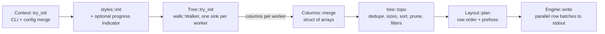

# Repository Guidelines

## Project Overview

`erdtree` (binary `erd`) is a cross-platform, multithreaded filesystem and disk-usage tool. It combines parts of `du`, `tree`, `find`, `wc`, and `ls`: it respects `.gitignore` and hidden-file rules, reports physical/logical/block/word/line sizes, supports regex/glob filtering, several layouts, sorting, icons, `LS_COLORS`, and a Unix long view.

## Architecture & Data Flow

Single Cargo package, single binary. `src/main.rs` is the only orchestration point:



- **Context** (`src/context/`): `Context` is a clap derive struct that also carries derived runtime state (column widths, color policy, predicates). `Reconciler::compute_args` in `src/context/args.rs` merges config per argument using clap `ValueSource`: an explicit CLI value wins, config replaces defaults. Argument relations (`requires`, the `searching` group) are NOT declared on `Context`; `with_relations` in `args.rs` adds them and they are enforced once on the merged args, so add new relations there. TOML keys are converted to `--kebab-case` args (`src/context/config/toml/mod.rs`); `false` booleans are omitted. `--no-config` skips config. Legacy `.erdtreerc` (`src/context/config/rc.rs`) takes precedence over TOML when present; named profiles (`-c NAME`) are TOML-only.
- **Walk** (`src/walk/`): `Walker` (configured by `walker()` in `src/tree/mod.rs`) runs one worker per `--threads`. A worker reads a whole directory with `std::fs::read_dir` (stat relative to the directory handle, not by full path), applies the ignore rules and the entry filter, and appends a record per kept entry to its own `Sink`. Directories move between workers through a shared queue only when a worker is idle. Entries whose metadata fails are dropped with their contents. `src/walk/rules.rs` is adapted from the `ignore` crate's `dir.rs`, so ignore-file precedence matches `ignore::WalkParallel`; `tests/walk_oracle.rs` checks the walk against that walker, so keep both in step when changing either.
- **Columns** (`src/tree/columns.rs`): each record becomes one row of struct-of-arrays columns (names arena, parent index, depth, file type, size, mode). Data only some options need (timestamps, `LS_COLORS` styles, long-view attributes) is collected only when `Probe` says so; symlink targets and multiply-linked inodes are sparse lists. All filesystem I/O happens here, during the walk; later stages are CPU only. Keep it that way.
- **Assembly** (`src/tree/mod.rs`, `src/tree/topo.rs`): `Columns::merge` concatenates the sinks and resolves parent references. `topo` holds the pure index algorithms (child lists, pre-order, hard-link dedupe, size totals, prune, dirs-only, min-size) with Kani proofs; child lists are sorted in parallel with the comparator in `src/tree/node/cmp.rs`, ties broken by name. `Node` (`src/tree/node/`) is a `Copy` view (`&Tree`, index) used by sorting and rendering.
- **Disk usage** (`src/disk_usage/`): metric variants (logical, physical, block, line, word) and unit prefixes. Physical size falls back to metadata length.
- **Render** (`src/render/`): generic `Engine<T>` with layouts `Regular`, `Inverted`, `Flat`, `FlatInverted` (`src/render/layout/`), rows in `src/render/grid/`, Unix long view in `src/render/long/`. A layout's `plan` decides row order and box-drawing prefixes sequentially (the `--follow` link theme is stateful); `Engine::write` formats rows in parallel batches into per-thread `String`s and writes them in order. Keep per-thread buffers local to their thread (shared neighbouring headers cause false sharing).
- **Styles** (`src/styles/`): global `OnceLock` themes and `LS_COLORS`. macOS `LSCOLORS` is not parsed. `NO_COLOR` uses `OnceLock` (`src/context/color.rs`).

Pitfalls:
- Walk order and record order are not tree order. Only assembly sorts.
- `--level` limits display only; traversal and size totals still cover the full tree. `--traversal-depth` (same depth numbering, root = 0) limits the walk itself (`Walker::max_depth`), so sizes and counts then cover only traversed entries.
- `--dirs-only`, prune and `--min-size` clear `alive` flags after sizes are computed; column widths are computed over all nodes except after `--min-size`.
- An inode reached more than once counts once, towards the entry not reached through a symlink, then with the least path.

## Key Directories

| Path | Purpose |
|---|---|
| `src/context/` | CLI args, config discovery/merge, platform options, `error.rs` |
| `src/walk/` | Parallel walker and ignore rules (`rules.rs`) |
| `src/tree/` | Columns, assembly, `topo.rs` algorithms and Kani proofs, `node/`, `error.rs` |
| `src/disk_usage/` | Size metrics (`file_size/`) and units |
| `src/render/` | Layout engine, grid, long view |
| `src/styles/`, `src/icons/` | Colors, themes, icons |
| `src/fs/` | Inode, Unix permissions, xattrs |
| `tests/` | Integration tests (one target per file), `tests/data/` fixtures |
| `example/` | `.erdtree.toml` (with `du`/`ls`/`rs` profiles) and legacy `.erdtreerc` |
| `assets/` | README screenshots only |
| `scripts/performance_metrics.sh` | macOS-only, needs root, purges disk cache, times `target/release/erd <args>` |

## Development Commands

Run commands inside the Nix dev shell (`flake.nix`, toolchain from `rust-toolchain.toml` via rust-overlay): `nix develop -c <cmd>`, or `nix develop` once.

```sh
cargo build                     # debug build
cargo run -- --threads 1 tests/data   # run erd on fixtures
cargo fmt --all -- --check      # CI gate; rustfmt.toml: match_block_trailing_comma = true
cargo clippy --all-targets --locked -- -D warnings   # CI gate
cargo test --locked             # CI gate (Linux, macOS, Windows)
cargo build --release --locked  # plain release build
dist plan                       # preview release artifacts (needs cargo-dist: nix shell nixpkgs#cargo-dist)
nix fmt flake.nix               # format flake.nix
nix flake check                 # crane checks: package build, clippy -D warnings, fmt, tests
nix build                       # crane release build (result/bin/erd); `nix run . -- <args>`
```

## Code Conventions & Common Patterns

- Rust edition 2024, MSRV 1.88 (`Cargo.toml`). Do not use std APIs newer than 1.88. Colors use `nu-ansi-term` (also enabled in `lscolors`); lazy statics use `std::sync::{OnceLock, LazyLock}`.
- Lints: `src/main.rs` enables `clippy::all`, `pedantic`, `nursery`, `cargo`, and more; CI denies all warnings. Fix lints instead of adding allows; a narrow `#[allow]` needs a comment with the reason (see `src/walk/mod.rs`).
- Errors: per-subsystem `thiserror` enums (`src/context/error.rs`, `src/context/config/toml/error.rs`, `src/tree/error.rs`) with `From` conversions and `?`. Only `main` prints errors (stderr, once) and sets the exit code.
- Platform code: gate with `#[cfg(unix)]` / `#[cfg(windows)]` at module, field, and match-arm level (see `src/fs/`, `src/tree/columns.rs`). Windows builds on stable (hard-link identity via `windows-sys` in `src/fs/inode.rs`); CI builds and tests Windows, so keep both platforms compiling.
- Options are `Copy` + clap `ValueEnum` enums where practical. Global immutable state uses `OnceLock`; no other shared mutable state.
- New CLI flag: add it to `Context` (or a sub-struct) with a doc comment (clap uses it as help text), make sure TOML kebab/snake keys map to it, then update the literal `erd --help` output in `README.md` (Usage section).
- `CONTRIBUTING.md`: rustdoc on every function/struct/trait; update README for user-visible changes; output changes need integration tests; open an issue before a PR. No commit-style rule is defined.

## Important Files

- `src/main.rs`: entry point, lint policy, renderer selection.
- `src/context/mod.rs`: all CLI options and defaults (threads default: `available_parallelism`, fallback 3).
- `src/context/args.rs`: CLI/config reconciliation.
- `src/context/config/toml/mod.rs`: TOML discovery. Unix order: `$ERDTREE_TOML_PATH`, `$XDG_CONFIG_HOME/erdtree/.erdtree.toml`, `$XDG_CONFIG_HOME/.erdtree.toml`, `$HOME/.config/erdtree/.erdtree.toml`, `$HOME/.erdtree.toml`. Windows: `%APPDATA%\erdtree\.erdtree.toml`. Legacy rc uses `$ERDTREE_CONFIG_PATH`.
- `src/walk/mod.rs`, `src/tree/mod.rs`: walk and tree assembly.
- `.github/workflows/ci.yml`: fmt, clippy, tests on Linux/macOS/Windows, MSRV `cargo check` on 1.88.0, `cargo deny check` (`deny` job, config in `deny.toml`: advisories, licenses allowlist, bans warn on duplicates/wildcards, crates.io-only sources), aggregated into the `ci-pass` job (the required check for `master`).
- `.github/workflows/release.yml`: generated by cargo-dist; never edit by hand. Config lives in `dist-workspace.toml` (targets, installers `shell`/`powershell`, sha256, attestations, native `ubuntu-24.04-arm` runners for aarch64 Linux, no crates.io publish) plus `[profile.dist]` in `Cargo.toml`. After changing config run `dist generate` (`dist generate --check` verifies it is current). `dist plan` runs on every PR; pushing a tag builds and publishes a GitHub Release.
- Release procedure: bump `version` in `Cargo.toml`, update `CHANGELOG.md`, merge, then push tag `vX.Y.Z` (any tag matching `**[0-9]+.[0-9]+.[0-9]+*` that matches the Cargo version; prerelease versions such as `v3.2.0-rc.1` publish as prereleases). The crate is not published to crates.io (that name is upstream's).
- `rust-toolchain.toml`: pinned dev/CI toolchain (1.99.0). Bump it deliberately and fix new lints in the same PR; `nix develop` and CI both follow it.
- `flake.nix` / `flake.lock`: dev shell, `packages.erdtree` (default), and `checks` (`erdtree`, `clippy`, `fmt`, `test`) built with crane. The crane source set is `commonCargoSources` plus `tests/`; add other non-Cargo files that builds or tests read to that fileset. Update with `nix flake update`.
- `CHANGELOG.md`: SemVer release notes.

## Runtime/Tooling Preferences

- Cargo; no workspace, no Cargo features, no profile overrides. CI installs the `rust-toolchain.toml` version with `rustup toolchain install`; the `msrv` job overrides it with `RUSTUP_TOOLCHAIN: 1.88.0`. When raising `rust-version` in `Cargo.toml`, update that job.
- Windows builds on stable Rust and runs in CI (clippy and tests). `tests/data` is marked `-text` in `.gitattributes` so fixture sizes stay byte-exact on Windows.
- Dependabot (`.github/dependabot.yml`) opens weekly PRs for `cargo` and `github-actions`. Run `cargo deny check` locally with `nix develop -c nix shell nixpkgs#cargo-deny -c cargo deny check`; new dependency licenses must be added to `deny.toml` deliberately.
- `Cargo.lock` is committed; releases build with `--locked`. Do not hand-edit it.

## Testing & QA

- Standard `#[test]` harness. No `assert_cmd` or snapshot crate. Dev deps: `indoc`, `strip-ansi-escapes`, `tempfile`.
- Integration tests call `tests/utils/mod.rs::run_cmd(&[...])`, which runs `cargo run -- --threads 1 --disk-usage logical --sort name --no-config <args>`, strips ANSI, trims, and panics with stderr on non-zero exit. Assert the full rendered tree against an `indoc!` string.
- Unit tests sit beside the code, for example `src/context/config/toml/test.rs`, `src/fs/permissions/test.rs` (Unix), `src/disk_usage/file_size/line_count.rs`.
- Run one test:
  ```sh
  cargo test --test sort sort_name -- --exact
  cargo test disk_usage::file_size::line_count::test_line_count -- --exact
  ```
- Adding a CLI test: new or existing `tests/<area>.rs` with `mod utils;`, use `tests/data/` fixtures, keep ordering explicit, use logical sizes (physical sizes differ by filesystem), gate Unix-only cases with `#[cfg(unix)]` (see `tests/symlink.rs`), use `tempfile::TempDir` for custom setups.
- Fixture caveats: changing anything in `tests/data/` changes expected sizes and trees across many tests. `tests/hardlink.rs` creates and removes `tests/hardlinks/curwin.hpl`; a panic can leave it behind. Permission tests write fixed names to the system temp dir and expect mode `644` (umask-sensitive).
- Formal verification: `mod spec` in `src/tree/topo.rs` states the properties of each `topo` function. `mod test` checks them exhaustively for every tree of up to 6 nodes and every root position (part of `cargo test`, about 18 s in debug); `mod proofs` (compiled only under `cfg(kani)`) checks them symbolically with Kani for every tree of 1 to 3 nodes, one harness per property and size (`topo::proofs::prune::n3`). Kani trees come from a depth-witness generator (equivalent to `spec::is_tree`); keep spec code free of loops over symbolic-length data and use the `ancestors` bitsets, as both blow up CBMC's memory. Run `cargo kani -j` (install: `cargo install --locked kani-verifier && cargo kani setup`; not in the dev shell). A change to a `topo` function needs its spec updated.
- No coverage target. PRs merge only when `ci-pass` succeeds (fmt, clippy `-D warnings`, tests on Linux/macOS/Windows, MSRV check, cargo-deny, Kani proofs).
