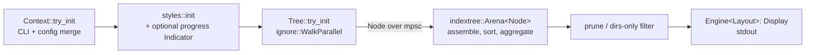

# Repository Guidelines

## Project Overview

`erdtree` (binary `erd`) is a cross-platform, multithreaded filesystem and disk-usage tool. It combines parts of `du`, `tree`, `find`, `wc`, and `ls`: it respects `.gitignore` and hidden-file rules, reports physical/logical/block/word/line sizes, supports regex/glob filtering, several layouts, sorting, icons, `LS_COLORS`, and a Unix long view.

## Architecture & Data Flow

Single Cargo package, single binary. `src/main.rs` is the only orchestration point:



- **Context** (`src/context/`): `Context` is a clap derive struct that also carries derived runtime state (column widths, color policy, predicates). `Reconciler::compute_args` in `src/context/args.rs` merges config per argument using clap `ValueSource`: an explicit CLI value wins, config replaces defaults. TOML keys are converted to `--kebab-case` args (`src/context/config/toml/mod.rs`); `false` booleans are omitted. `--no-config` skips config. Legacy `.erdtreerc` (`src/context/config/rc.rs`) takes precedence over TOML when present; named profiles (`-c NAME`) are TOML-only.
- **Traversal** (`src/tree/mod.rs`, `src/tree/visitor.rs`): `WalkParallel::try_from(&Context)` configures the `ignore` crate. One `Branch` visitor per worker turns `DirEntry` into `Node` and sends it on a channel. Entries that fail are skipped silently; channel failure stops the walk.
- **Assembly**: a scoped consumer stores nodes in an `indextree::Arena` with a parent-path branch map, attaches sorted children (`src/tree/node/cmp.rs`), sums directory sizes, and deduplicates hard links by inode. Prune/filter runs after aggregation.
- **Node** (`src/tree/node/`): all filesystem I/O (metadata, symlink target, size, style, inode, Unix attrs) happens in node construction. Later stages are CPU only. Keep it that way.
- **Disk usage** (`src/disk_usage/`): metric variants (logical, physical, block, line, word) and unit prefixes. Physical size falls back to metadata length.
- **Render** (`src/render/`): generic `Engine<T>` with layouts `Regular`, `Inverted`, `Flat`, `FlatInverted` (`src/render/layout/`), rows in `src/render/grid/`, Unix long view in `src/render/long/`. Renderers implement `Display`.
- **Styles** (`src/styles/`): global `OnceLock` themes and `LS_COLORS`. macOS `LSCOLORS` is not parsed. `NO_COLOR` uses `OnceCell` (`src/context/color.rs`).

Pitfalls:
- `WalkParallel` visit order is not tree order. Only post-collection assembly sorts.
- `--level` limits display only; traversal and size totals still cover the full tree.
- `--dirs-only` and prune detach nodes after sizes are computed.

## Key Directories

| Path | Purpose |
|---|---|
| `src/context/` | CLI args, config discovery/merge, platform options, `error.rs` |
| `src/tree/` | Parallel walk, visitor, arena tree, `node/`, `error.rs` |
| `src/disk_usage/` | Size metrics (`file_size/`) and units |
| `src/render/` | Layout engine, grid, long view |
| `src/styles/`, `src/icons/` | Colors, themes, icons |
| `src/fs/` | Inode, Unix permissions, xattrs |
| `tests/` | Integration tests (one target per file), `tests/data/` fixtures |
| `example/` | `.erdtree.toml` (with `du`/`ls`/`rs` profiles) and legacy `.erdtreerc` |
| `assets/` | README screenshots only |
| `scripts/performance_metrics.sh` | macOS-only, needs root, purges disk cache, times `target/release/erd <args>` |

## Development Commands

Run commands inside the Nix dev shell (`flake.nix`, nixpkgs Rust toolchain): `nix develop -c <cmd>`, or `nix develop` once.

```sh
cargo build                     # debug build
cargo run -- --threads 1 tests/data   # run erd on fixtures
cargo fmt --all -- --check      # CI gate; rustfmt.toml: match_block_trailing_comma = true
cargo clippy --all-targets --locked -- -D warnings   # CI gate
cargo test --locked             # CI gate (Linux + macOS)
cargo build --release --locked  # release build as in publish.yml
nix fmt                         # format flake.nix
```

## Code Conventions & Common Patterns

- Rust 2021, MSRV 1.70.0 (`Cargo.toml`). Do not use std APIs newer than 1.70.
- Lints: `src/main.rs` enables `clippy::all`, `pedantic`, `nursery`, `cargo`, and more; CI denies all warnings. Fix lints instead of adding allows; a narrow `#[allow]` needs a comment with the reason (see `src/tree/visitor.rs`).
- Errors: per-subsystem `thiserror` enums (`src/context/error.rs`, `src/context/config/toml/error.rs`, `src/tree/error.rs`) with `From` conversions and `?`. Only `main` prints errors (stderr, once) and sets the exit code.
- Platform code: gate with `#[cfg(unix)]` / `#[cfg(windows)]` at module, field, and match-arm level (see `src/fs/`, `src/tree/node/unix.rs`). Windows needs nightly (`windows_by_handle` feature in `src/main.rs`); do not break the stable Unix build.
- Options are `Copy` + clap `ValueEnum` enums where practical. Global immutable state uses `OnceLock`; no other shared mutable state.
- New CLI flag: add it to `Context` (or a sub-struct) with a doc comment (clap uses it as help text), make sure TOML kebab/snake keys map to it, then update the literal `erd --help` output in `README.md` (Usage section).
- `CONTRIBUTING.md`: rustdoc on every function/struct/trait; update README for user-visible changes; output changes need integration tests; open an issue before a PR. No commit-style rule is defined.

## Important Files

- `src/main.rs`: entry point, lint policy, renderer selection.
- `src/context/mod.rs`: all CLI options and defaults (threads default: `available_parallelism`, fallback 3).
- `src/context/args.rs`: CLI/config reconciliation.
- `src/context/config/toml/mod.rs`: TOML discovery. Unix order: `$ERDTREE_TOML_PATH`, `$XDG_CONFIG_HOME/erdtree/.erdtree.toml`, `$XDG_CONFIG_HOME/.erdtree.toml`, `$HOME/.config/erdtree/.erdtree.toml`, `$HOME/.erdtree.toml`. Windows: `%APPDATA%\erdtree\.erdtree.toml`. Legacy rc uses `$ERDTREE_CONFIG_PATH`.
- `src/tree/mod.rs`, `src/tree/visitor.rs`: walk and tree assembly.
- `.github/workflows/ci.yml`: fmt, clippy, tests on Linux/macOS, MSRV `cargo check` on 1.70.0, aggregated into the `ci-pass` job (the required check for `master`). `publish.yml` (tag-triggered release, 7 targets, Windows on `nightly-2023-06-11`), `test.yml` (manual prerelease).
- `flake.nix` / `flake.lock`: dev shell. Update with `nix flake update`.
- `CHANGELOG.md`: SemVer release notes.

## Runtime/Tooling Preferences

- Cargo; no workspace, no Cargo features, no profile overrides. Local toolchain comes from the flake (current stable); CI uses `dtolnay/rust-toolchain@stable` plus a 1.70.0 MSRV job. When raising `rust-version` in `Cargo.toml`, update the `msrv` job in `ci.yml`.
- Windows requires nightly (hard-link support) and is not built in CI yet; the Windows-only config code in `src/context/config/toml/mod.rs` does not compile.
- `Cargo.lock` is committed; releases build with `--locked`. Do not hand-edit it.

## Testing & QA

- Standard `#[test]` harness. No `assert_cmd` or snapshot crate. Dev deps: `indoc`, `strip-ansi-escapes`, `tempfile`.
- Integration tests call `tests/utils/mod.rs::run_cmd(&[...])`, which runs `cargo run -- --threads 1 --disk-usage logical --sort name --no-config <args>`, strips ANSI, trims, and panics with stderr on non-zero exit. Assert the full rendered tree against an `indoc!` string.
- Unit tests sit beside the code, for example `src/context/config/toml/test.rs`, `src/fs/permissions/test.rs` (Unix), `src/disk_usage/file_size/line_count.rs`.
- Run one test:
  ```sh
  cargo test --test sort sort_name -- --exact
  cargo test disk_usage::file_size::line_count::test_line_count -- --exact
  ```
- Adding a CLI test: new or existing `tests/<area>.rs` with `mod utils;`, use `tests/data/` fixtures, keep ordering explicit, use logical sizes (physical sizes differ by filesystem), gate Unix-only cases with `#[cfg(unix)]` (see `tests/symlink.rs`), use `tempfile::TempDir` for custom setups.
- Fixture caveats: changing anything in `tests/data/` changes expected sizes and trees across many tests. `tests/hardlink.rs` creates and removes `tests/hardlinks/curwin.hpl`; a panic can leave it behind. Permission tests write fixed names to the system temp dir and expect mode `644` (umask-sensitive).
- No coverage target. PRs merge only when `ci-pass` succeeds (fmt, clippy `-D warnings`, tests on Linux/macOS, MSRV check).
